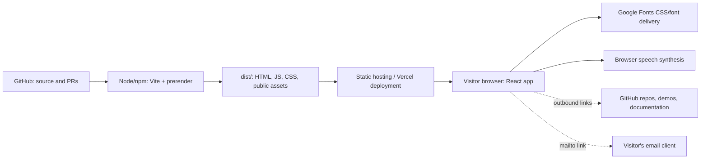
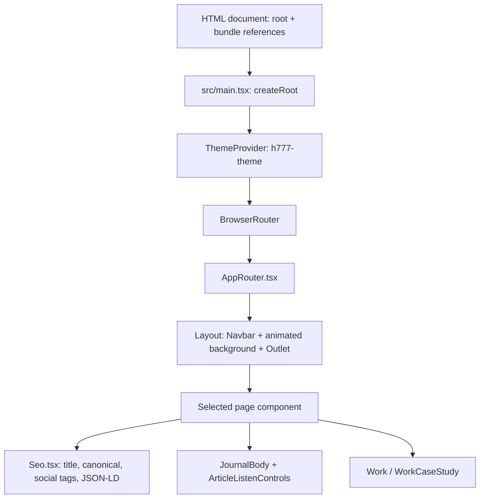
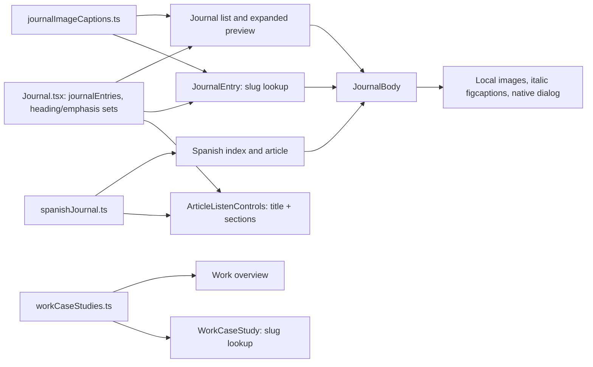
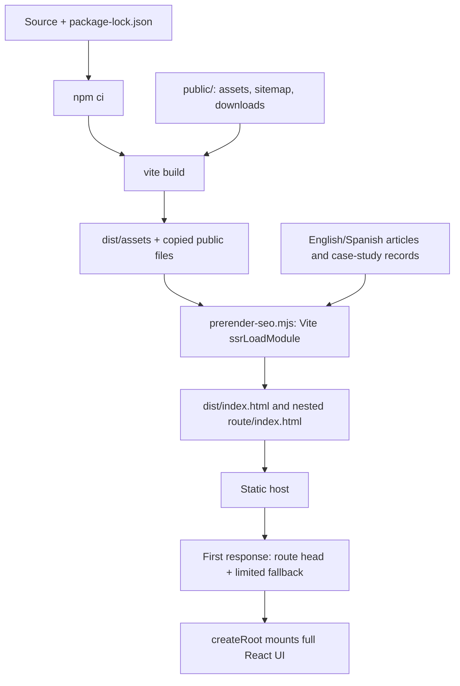
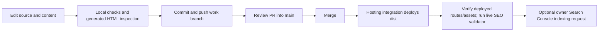

# Site Architecture & Project Topology

Last reconciled with repository code: **November 11, 2026**.

This is the primary, single-document reference for the implemented h777 portfolio:
its system boundaries, directory structure, routes, content flow, rendering,
assets, build, validation, and release workflow. Dated release logs and downloadable
archives are historical evidence; this file describes the current implementation.

## 1. System Boundary

The portfolio is a **React/Vite static frontend** with client-side routing and
build-time generation of route metadata and limited fallback HTML. It has no
application API server, database, user-authentication service, or required secrets.
The tools described in Work/Lab are external projects; their hosted APIs, databases,
and authentication are not dependencies required to run this portfolio.



The repository includes `vercel.json` and `public/_redirects`. Hosting integration,
production deployment status, and DNS live outside the application code. This
reference does not claim a fresh production or Search Console validation.

## 2. Runtime Topology



Startup order:

1. The host serves an HTML document and the referenced assets.
2. `src/main.tsx` calls `createRoot(...).render(...)`.
3. `ThemeProvider` applies a class-based theme; default is dark, system selection
   is disabled, and the storage key is `h777-theme`.
4. `BrowserRouter` passes the browser path to `AppRouter`.
5. `Layout` retains `Navbar`, `BeatingBrain`, three `RollingHeptagon` instances,
   and the child-route `<Outlet />` across navigation.
6. A static page or slug-based content page renders; `Seo` updates browser metadata.

**This is client mounting, not React hydration.** The build's fallback HTML is
placed inside `#root`, but `main.tsx` uses `createRoot`, not `hydrateRoot`. React
replaces that limited fallback with its client-rendered UI. The build does not
server-render the complete article body or image-dialog controls.

## 3. Repository Structure

```text
calmCommandCenter/
├── index.html                     # Browser shell; initial head and favicon links
├── package.json                   # npm scripts, engines, dependencies
├── package-lock.json              # Dependency installation source of truth
├── .nvmrc / .node-version          # Recommended Node 22.18.0
├── vite.config.ts                 # React/Tailwind plugins; @ -> src alias
├── tsconfig.json                  # Strict browser TypeScript, noEmit
├── tsconfig.node.json             # Vite config type checking
├── postcss.config.mjs
├── vercel.json                    # Host rewrite declaration
├── src/
│   ├── main.tsx                   # Provider/router entry; global CSS import
│   ├── vite-env.d.ts
│   ├── styles/                    # Tailwind, themes, typography, global CSS
│   └── app/
│       ├── App.tsx                # English home
│       ├── AppRouter.tsx           # All current route definitions
│       ├── Layout.tsx             # Persistent page shell
│       ├── constants/heptagons.ts
│       ├── components/
│       │   ├── Navbar.tsx         # Navigation, theme control, language maps
│       │   ├── Seo.tsx            # Client metadata and schema
│       │   ├── JournalBody.tsx    # Text, figures, captions, image dialog
│       │   ├── ArticleListenControls.tsx
│       │   ├── RelatedLinks.tsx
│       │   ├── BeatingBrain.tsx
│       │   ├── RollingHeptagon.tsx
│       │   ├── Spiral.tsx
│       │   └── shared/ImageWithFallback.tsx
│       ├── data/
│       │   ├── journalImageCaptions.ts
│       │   ├── workCaseStudies.ts
│       │   ├── spanishJournal.ts
│       │   └── spanishSiteCopy.ts
│       └── pages/
│           ├── Journal.tsx        # English content records + expandable index
│           ├── JournalEntry.tsx   # English article by slug
│           ├── Work.tsx
│           ├── WorkCaseStudy.tsx
│           ├── Lab.tsx
│           ├── About.tsx
│           ├── Contact.tsx
│           ├── NotFound.tsx
│           └── es/
│               ├── SpanishHome.tsx
│               ├── SpanishContact.tsx
│               ├── SpanishJournal.tsx
│               └── SpanishJournalEntry.tsx
├── scripts/
│   ├── prerender-seo.mjs           # Post-Vite metadata/fallback generation
│   ├── validate-seo.mjs            # Requests external deployed h777.dev pages
│   ├── validate-performance.mjs    # Local bundle and Work-image size checks
│   └── lint-source.mjs             # Repository-specific source checks
├── tests/content-data.test.mjs     # Node tests, React static rendering, Vite loading
├── public/
│   ├── sitemap.xml / robots.txt
│   ├── og.png / og-card.svg        # Social assets
│   ├── favicon-v2-16.png
│   ├── favicon-v2-32.png
│   ├── favicon-v2-64.png
│   ├── favicon.ico                # 16/32/48px variants
│   ├── favicon.svg                # Original retained asset
│   ├── images/journal/            # PNG, SVG, WebP evidence and illustrations
│   ├── images/work/               # Case-study screenshots
│   ├── downloads/                 # HTML, PDF, ZIP reading/social kits
│   └── _redirects                 # Static-host SPA fallback declaration
├── docs/
│   ├── architecture/              # This reference and supporting teaching docs
│   ├── seo/                       # Checklist, progress log, dated release evidence
│   ├── next-steps/portfolio-review/ # HTML proposal and owner review worksheet
│   ├── content-workbook/
│   ├── product-requirements/
│   └── build-log/
└── dist/                          # Generated, ignored; not source content
```

There is no current `src/app/components/ui/` directory or installed Radix/shadcn
runtime component library. Legacy theme/attribution files do not imply those
components remain installed. Temporary generation scripts and generated image
masters outside this checkout are not guaranteed reproducible repository tooling.

## 4. Routes and Content Ownership

`src/app/AppRouter.tsx` defines the following route families:

| Route | Component / content owner |
|---|---|
| `/` | `App.tsx` |
| `/journal` | `Journal.tsx`; expandable English article previews |
| `/journal/:slug` | `JournalEntry.tsx`; published `journalEntries` lookup |
| `/work` | `Work.tsx`; shared case-study data plus overview-specific copy |
| `/work/:slug` | `WorkCaseStudy.tsx`; `workCaseStudies` lookup |
| `/lab` | `Lab.tsx`; experiment explanations and links |
| `/about` | `About.tsx` |
| `/contact` | `Contact.tsx`; email links, no submission backend |
| `/es` | `SpanishHome.tsx`; `spanishSiteCopy` |
| `/es/contacto` | `SpanishContact.tsx` |
| `/es/notas` | `SpanishJournal.tsx`; `spanishJournalEntries` |
| `/es/notas/:slug` | `SpanishJournalEntry.tsx` |
| `*` | `NotFound.tsx` |

Current public page count: **26** — six English index/static pages, 12 English
articles, three Work detail pages, three Spanish index/static pages, and two
Spanish articles. Image/download URLs are static assets, not sitemap page entries.
The 404 component does not by itself guarantee an HTTP 404 status from the host.

The proposed `/tools` directory and additional project pages are **not implemented**.
The current visible navigation remains Journal, Lab, Work, About, and Contact.

## 5. Data and Rendering Flow



### English Journal

`Journal.tsx` exports the English article records, `journalSubheads`, and
`journalStrongLines`. `JournalEntry` imports them and selects the record matching
the slug with `comingSoon === false`. Missing/unpublished records use `NotFound`.
Record fields include label, slug, title, read time, category, display/ISO date,
excerpt, sections, publication state, and related links.

A `sections` string renders as a heading, emphasized paragraph, normal paragraph,
or supported standalone image. The two sets select exact strings; there is no
full Markdown parser. React escapes displayed text. Only explicit inline HTTPS
Markdown links, triple-star `***bold italic***` spans, and local image paths matching the renderer's restricted pattern
are interpreted. Raw HTML, unsupported schemes, and arbitrary external image
Markdown are not interpreted. This is a controlled-content renderer, not a
comprehensive sanitizer for arbitrary uploaded HTML/SVG.

### Captions and image interaction

`journalImageCaptions.ts` is an image-path-keyed map of source/provenance strings.
English callers pass it through `imageCaptions`; Spanish callers currently use
the shared renderer's default empty map. Captions render inside `<figure>` in
smaller italic `<figcaption>` text, with supported source links retained.
They are separate from narrative sections and therefore are not read as ordinary
article text by `ArticleListenControls`.

FN 11 and FN 12 opt into `compactImages`: centered, fluid-width figures capped at
560px. The prop defaults to false. All supported Journal images can open a native
`<dialog>` from a keyboard-accessible button. The modal supports Close, Escape,
and outside-click dismissal; background scrolling is restored on close. Native
modal focus behavior contains focus and restores it to the trigger. A sections
change closes an open dialog. Original-image links remain available in a new tab.

### Speech and localization

`ArticleListenControls` uses browser speech synthesis, chunking the title and
sections, with play/pause/resume/restart/stop behavior. Markdown links normalize
to labels; image strings normalize to alt text; triple-star emphasis markers are removed. Spanish callers request `es-MX`;
English callers retain browser language selection. Voice availability depends on
the browser/platform; no portfolio speech API server is configured.

Spanish coverage is partial. Navbar language maps explicitly pair supported
routes, including English FN 10 and Spanish Nota 2. FN 11/12 do not have Spanish
article counterparts merely because a language toggle exists.

### Work and Lab

`workCaseStudies.ts` supplies both Work detail pages and the overview. `Work.tsx`
also maintains overview-specific descriptions, badges, and screenshot selections;
changes to those can still drift from shared detail content. Related links are
editorial records, not an automatically generated relationship graph.

Lab content remains in `Lab.tsx`. Featured products are outbound references, not
portfolio services. In particular, the existing TurnFlow case study links to
`turnflow-mvp`, while FN 11's inspected evidence links to `turnflow-home`.

## 6. Build and SEO Topology



`npm run build` runs `vite build && npm run prerender:seo`. The script loads data
through Vite's `ssrLoadModule` so TypeScript/TSX imports resolve. That module-loading
mechanism is not a production SSR server. English/Spanish article routes and Work
detail routes are derived from records; base-page metadata is defined in the script.

The script writes titles, descriptions, canonical URLs, social tags, JSON-LD,
breadcrumbs, and limited visible fallback content. It does not copy every article
paragraph or image into the static fallback. `Seo.tsx` updates head information
again after client navigation. Both `index.html` and the prerender head template
must declare the same favicon assets.

`public/sitemap.xml` and the expected-schema map in `validate-seo.mjs` are maintained
separately. They do not automatically change when an article record is added.
The live validator derives its expected URL count from that map rather than a
separate numeric constant. Keep all 26 current entries consistent when adding routes.

## 7. Public Assets, Favicon, and Downloads

Files in `public/` are copied to `dist/` and requested from root-relative URLs:

| Source | Served URL |
|---|---|
| `public/images/journal/fn-twelve-checkmark-lock.webp` | `/images/journal/fn-twelve-checkmark-lock.webp` |
| `public/favicon-v2-32.png` | `/favicon-v2-32.png` |
| `public/downloads/fn11-linkedin-carousel.pdf` | `/downloads/fn11-linkedin-carousel.pdf` |
| `public/downloads/fn12-archive-and-linkedin-kit.zip` | `/downloads/fn12-archive-and-linkedin-kit.zip` |

Active favicon declarations select 16/32/64px PNGs plus `/favicon.ico?v=2`.
The ICO contains 16/32/48px variants. The old SVG remains but is not the active
head selection. Versioned paths reduce reuse of cached older icons.

Journal assets distinguish original demo screenshots, typeset source/log evidence,
historical measurements, and generated editorial artwork. The checkmark/lock image
is labeled AI-generated and is not an inspection photograph or customer record.

The downloadable kits contain static HTML, text, PDF, and/or images. They do not
execute a server or write to GitHub. The review worksheet exports filled HTML;
source edits or uploads must be saved through GitHub. GitHub raw HTML is delivered
as text, so ZIP extraction plus local browser opening is the documented reading
workflow. Downloaded archives retain their historical snapshot rather than tracking
this architecture reference automatically.

## 8. Toolchain and Local Commands

Node 22.18.0 is pinned/recommended; engines require Node >=22.12 and npm >=10.
`packageManager` declares npm 10.9.3. Onboarding also validated Node 24.19.0/npm 11.9.0;
that observation does not change the repository pins. The `@` alias means `src/`
and is paired between Vite and TypeScript configuration.

```bash
cd /workspace/calmCommandCenter   # Or your own checkout root
npm ci
npm run dev -- --host 127.0.0.1 --port 5173 --strictPort
```

`npm start` uses the browser-opening local launcher. For automation, the explicit
`dev` command avoids that launcher. No database, application credentials, or project
backend is required to develop the portfolio. Package installation needs registry
access; typography requests Google Fonts CSS/font delivery at runtime. Outbound
project links require access to their respective destinations.

## 9. Validation and Its Limits

```bash
npm test
npm run lint
npm run build:check
npm run validate:performance
# After a real deployment, with access to the deployed site:
npm run validate:seo
```

| Check | Scope / limitation |
|---|---|
| `test` | Nine current Node tests using Vite-loaded modules and React static markup. Content routes/links, controlled rendering, Spanish content, FN 12 assets, video URL, and captions. Not a complete browser/integration suite. |
| `lint` | Custom `lint-source.mjs` rules; not ESLint and not a full security audit. |
| `typecheck` | Strict TypeScript checks for source and Vite config; no emitted app files. |
| `build:check` | Type check, Vite build, and route metadata/fallback generation. |
| `validate:performance` | Built JS/CSS sizes and Work screenshot budgets. Does not budget Journal images, downloads, real-user latency, or Core Web Vitals. |
| `validate:seo` | External HTTP requests to `https://h777.dev`; checks deployed sitemap/routes, head tags, fallback content, schema, breadcrumbs, and social assets. Does not prove local build deployment. |

Previous Playwright/Chromium checks covered 1440px and 390px viewports, captions,
loaded images, full-size links, modal focus/closing/scroll behavior, and overflow.
Those were temporary scripts, not committed browser-test infrastructure. Recheck
these interactions after UI changes. Speech behavior and comprehensive accessibility
coverage were not established by those checks.

## 10. Release and Hosting Boundaries



The intended deployment flow uses GitHub and Vercel. Host integration settings
must be checked independently; a commit, push, or build is not deployment evidence.
Static hosting must serve existing files, including nested generated pages, before
SPA fallback. Otherwise metadata and downloads can be replaced by the generic shell.
Current rewrite declarations are in `vercel.json` and `public/_redirects`; this
documentation update does not change them or prove their live precedence.

Rollback uses a reviewable `git revert` and normal deployment workflow. No database
migration is involved. Revert asset references and files consistently. Do not
force-push shared history to undo a content release.

Use the [content release checklist](../seo/content-release-checklist.md) for new
articles/media and the [SEO progress log](../seo/seo-progress-log.md) for chronology.

## 11. Remaining Architecture Tradeoffs

- English content lives in a page module, so data consumers import that module and
  its dependencies. A dedicated content module would reduce coupling.
- Sitemap, route metadata, validator expectations, language maps, and runtime pages
  still need coordinated updates; a shared content manifest is proposed, not built.
- Work overview consumes shared case-study data but keeps some editorial copy locally.
- Compact image selection currently checks the FN 11/12 slugs; explicit per-article
  media presentation metadata would scale better as more layouts are required.
- Journal images do not currently declare intrinsic width/height attributes. Full-size
  links do not replace accessible text explanations for code in images.
- Generated cards, archives, and social kits were produced with temporary tooling;
  the repository does not contain a complete asset-regeneration pipeline.
- A native image modal depends on modern browser `<dialog>` support.
- The source has no portfolio-specific CI workflow in `.github/workflows/` at this
  inspection; checks described here are npm scripts/manual release procedures.
- HTML files in `docs/next-steps/` are proposals/review assets, not automatically public
  application routes. `public/downloads/` files are intentionally served static assets.

## 12. Supporting Documents

- [README](../../README.md): onboarding, current routes, downloads, and project status.
- [Code glossary](code-glossary.md): definitions and code patterns.
- [Problem / algorithm / pseudocode / flowchart](problem-algorithm-pseudocode-flowchart.md): teaching companion.
- [Explain-the-code practice guide](explain-the-code-practice-guide.md): presentation drills.
- [FN 12 release record](../seo/field-note-12-2026-11-09.md): source provenance and original publication checks.
- [Portfolio review](../next-steps/portfolio-review/index.html): proposed future information architecture.

The source code and package manifests remain authoritative if implementation changes
before these documents are updated.
